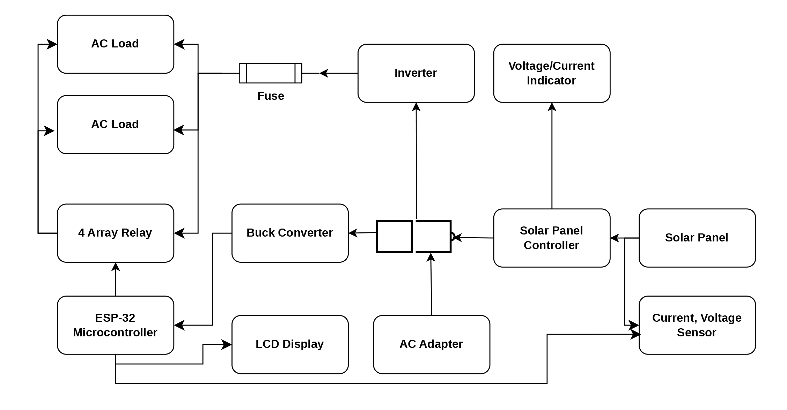
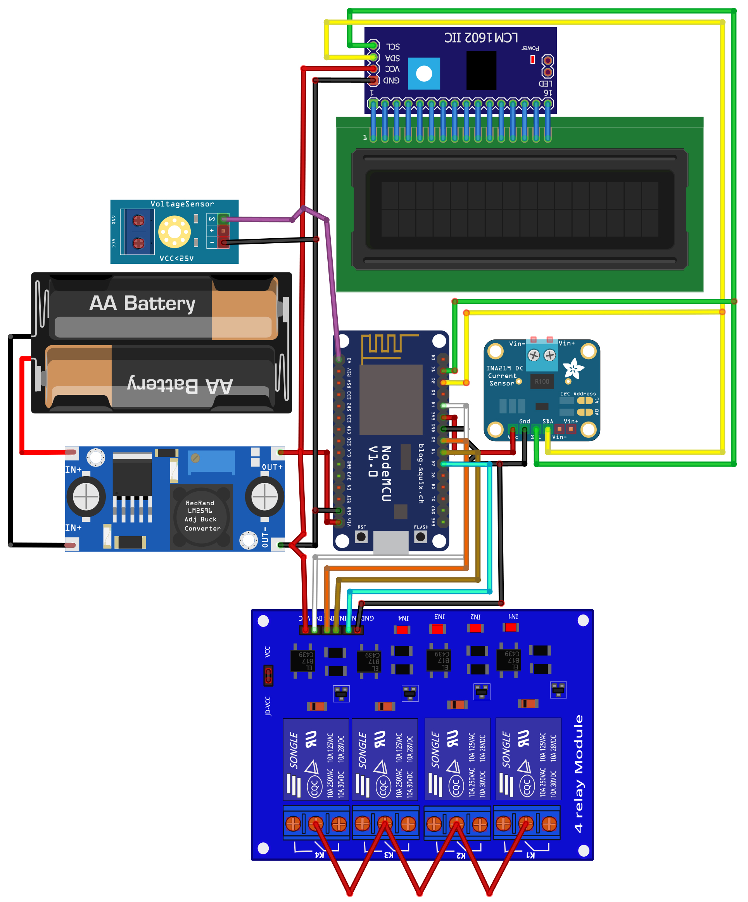
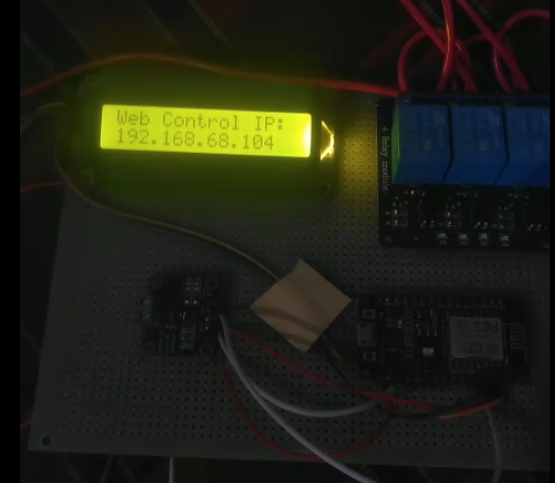
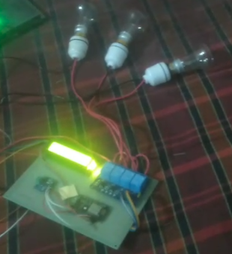
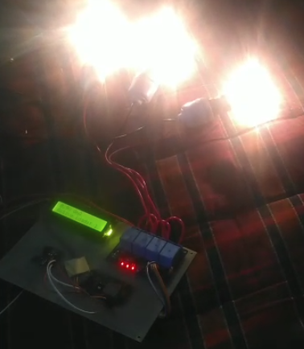

# VoltSense: An IoT Based Smart Home Controlling System

## Overview
This project presents an IoT-based smart inverter and home controlling system designed to enable real-time data acquisition, remote monitoring, and intelligent control over electrical networks[cite: 44]. The architecture provides a low-cost, scalable, and environmentally friendly solution suited for both small and large residential areas[cite: 46]. By interconnecting sensors and control mechanisms through a Wi-Fi network, the system modernizes power management and improves overall energy efficiency[cite: 44, 46, 52].

## Core Features
*   **Real-Time Dashboard:** Hosts a local HTML web server that automatically refreshes every 3 seconds to display live bus voltage, current (mA), and power (mW)[cite: 54].
*   **Remote Load Management:** Features a web-based interface with dedicated toggle buttons to independently control four AC loads via a relay module[cite: 54].
*   **Hardware Failsafes:** Incorporates startup ping checks for the I2C LCD and INA219 sensor, ensuring the web server and relay controls remain operational even if peripheral sensors disconnect[cite: 54].
*   **Dynamic Local Display:** Utilizes a non-blocking timer to alternate the physical 16x2 LCD screen between showing the network IP address and the live sensor telemetry/active load count every 3 seconds[cite: 54].
*   **System Protection:** Enables early fault detection, automatic power switching, and efficient solar system management[cite: 51].

## Hardware Architecture
The system integrates power conversion hardware with edge-computing microcontrollers:
*   **Power Generation & Storage:** 12-18V Solar Panel, 12V Solar Charge Controller, and a 12V Rechargeable Battery[cite: 49].
*   **Inversion:** 12V DC to 220V AC Inverter Module[cite: 49].
*   **Processing & Connectivity:** ESP8266 Microcontroller with a Wi-Fi Router connection[cite: 49, 54].
*   **Sensing & Display:** INA219 Current/Power Sensor and a 16x2 I2C LCD (address 0x27)[cite: 49, 54].
*   **Actuation & Regulation:** 4-Channel Relay Module (mapped to GPIOs 14, 12, 13, 0) and a step-down Buck Converter[cite: 49, 54].

## System Diagrams & Prototypes

*   **Block Diagram:** 
    

*   **Circuit Diagram:** 
    

*   **Flow Chart:** 
    

*   **Hardware Prototypes:** 
    

      
      
      
    

## Source Code
The complete firmware is located in the `Source_Code/Esp-8266_Source_Code.ino` file[cite: 55]. The system is programmed in C/C++ using the Arduino IDE and relies on standard libraries including `<ESP8266WiFi.h>`, `<ESP8266WebServer.h>`, `<Wire.h>`, `<Adafruit_INA219.h>`, and `<LiquidCrystal_I2C.h>`[cite: 54].

## Documentation Reference
For a deeper understanding of the system's mathematics, waveform topologies, and project planning, please email at: baker.cse@isu.ac.bd or mdbaker243@gmail.com
